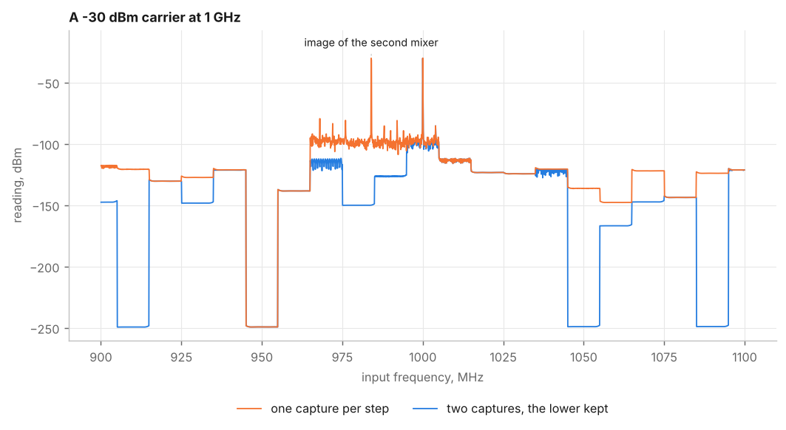
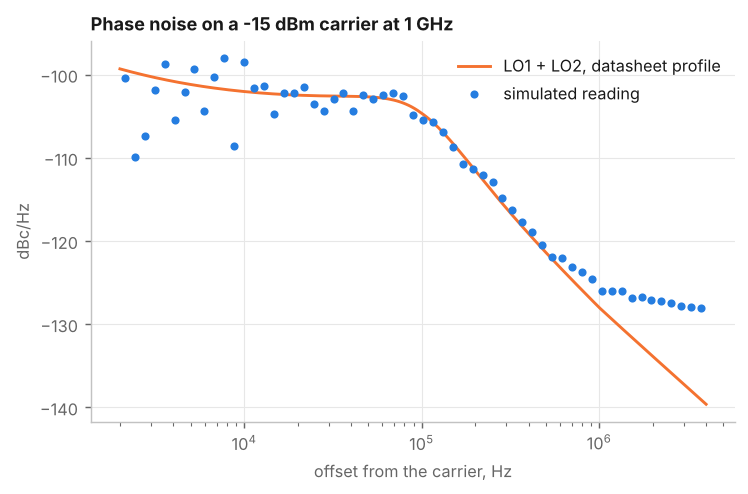
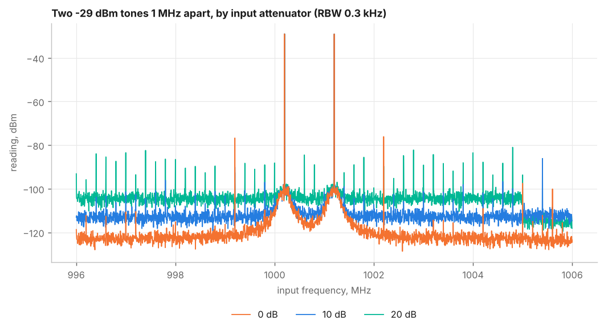
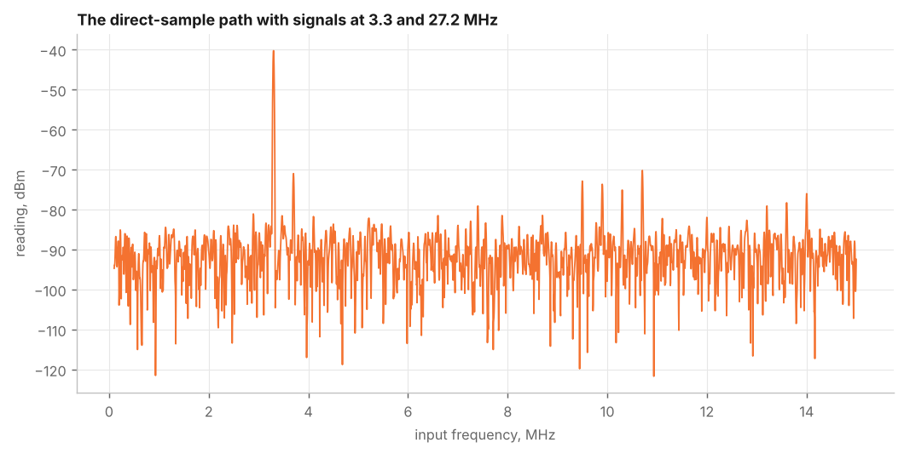
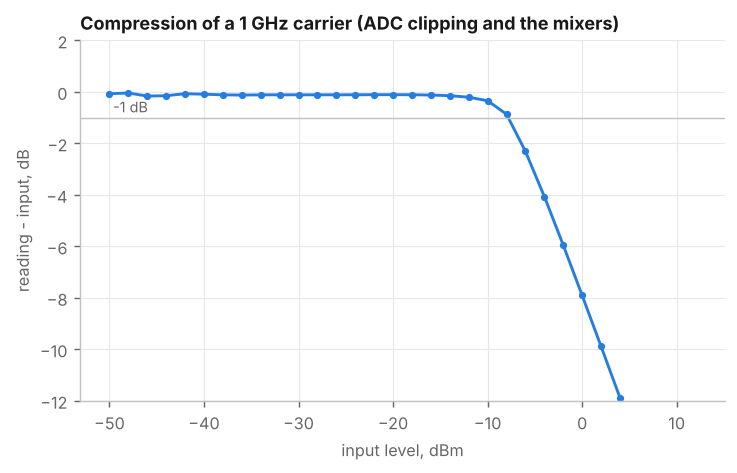
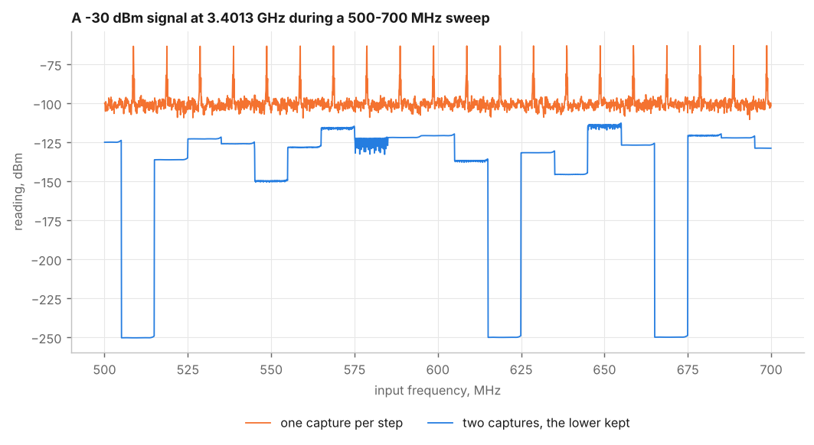
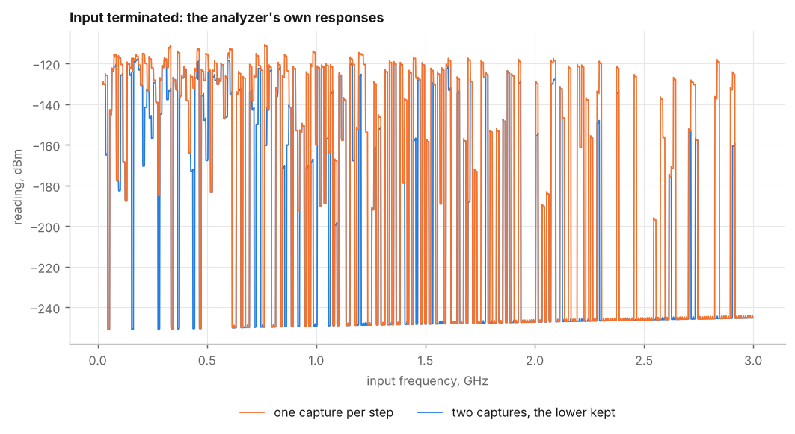
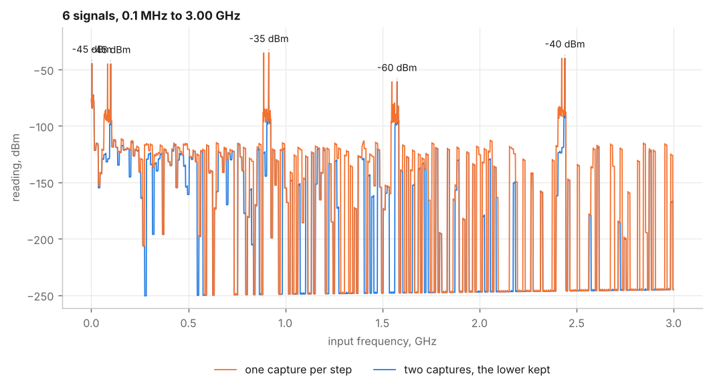
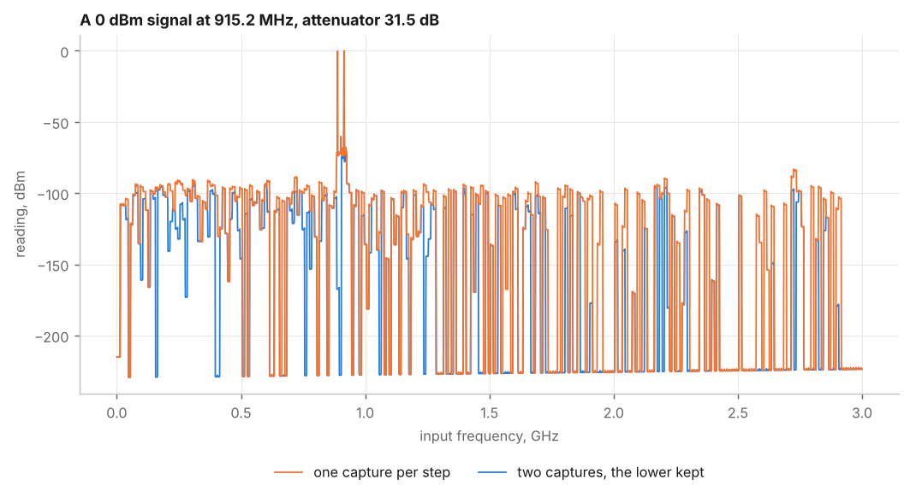

# Spectrum analyzer simulation: the board's chain

LO1 LMX2572, LO2 LMX2572, two SIM-83+, 40 MSPS SD9609-40 (as an AD9609-40), 4096-point captures.

## The board's chain against the proposal's

|  | board, as drawn | proposal, preamp bypassed | proposal, preamp in |
|---|---|---|---|
| highest frequency | 3.00 GHz | 5.49 GHz | 5.49 GHz |
| noise figure of the chain alone, dB | 7.3 | 21.1 | 8.0 |
| noise figure with the image and the ADC, dB | 20.7 | 24.4 | 11.0 |
| noise floor, dBm/Hz | -153.3 | -149.6 | -163.0 |
| chain noise at the ADC, LSB rms (0.5 or more dithers it) | 0.08 | 1.26 | 3.16 |
| smallest signal seen alone in a 19.6 kHz RBW, dBm | -73 (one LSB) | -107 | -120 |
| IIP3, dBm | -7.0 | +9.1 | -11.9 |
| ADC full scale at the input, dBm | -19.2 | -16.3 | -37.4 |
| level at the first mixer when the ADC is at full scale, dBm | -2.5 | -24.1 | -24.1 |
| largest input that keeps the first mixer at -25 dBm (most attenuation), dBm | -10.2 | +14.5 | -6.6 |
| largest input before the ADC clips or the mixer compresses, dBm | +12.3 | +15.4 | -5.7 |
| a signal on the first IF reads this many dB down | 33 | 85 | 89 |
| two -30 dBm signals at 3.90 and 4.95 GHz make, at 1050 MHz, dBm | -97 | nothing | nothing |

At 1 GHz with the input attenuator at 0 dB, except the two largest-input rows. The mixer is a level 7 part: clean to about -25 dBm, 1 dB compressed at +1 dBm. The last two rows are what the chain makes ahead of the ADC, referred to the input.

## Budget

Input attenuator 10 dB, IF attenuator 0 dB, input buffer bypassed. The first IF is 3.400 GHz (this filter's centre) and the second 12 MHz; the superheterodyne path ends at 3.00 GHz.

| f, GHz | band | gain to ADC, dB | NF (Friis), dB | NF (effective), dB | noise floor, dBm/Hz | IIP3, dBm | P1dB in, dBm | ADC full scale, dBm | SFDR, dB (1 Hz) |
|---|---|---|---|---|---|---|---|---|---|
| 0.005 | D | 6.6 | 17.6 | 42.9 | -131.1 | +18.4 | +8.4 | +3.4 | 100 |
| 0.1 | S | 20.8 | 16.7 | 29.2 | -144.8 | +1.3 | -7.9 | -10.8 | 97 |
| 0.5 | S | 20.3 | 16.9 | 29.6 | -144.4 | +1.8 | -7.5 | -10.3 | 97 |
| 1 | S | 19.2 | 17.3 | 30.7 | -143.3 | +3.0 | -6.3 | -9.2 | 98 |
| 1.5 | S | 18.2 | 17.6 | 31.6 | -142.4 | +3.9 | -5.4 | -8.2 | 98 |
| 2 | S | 17.3 | 18.0 | 32.5 | -141.5 | +4.9 | -4.4 | -7.3 | 98 |
| 2.29 | S | 16.7 | 18.2 | 33.1 | -140.9 | +5.5 | -3.8 | -6.7 | 98 |
| 2.5 | S | 16.2 | 18.3 | 33.5 | -140.5 | +5.9 | -3.4 | -6.2 | 98 |
| 3 | S | 15.2 | 18.8 | 34.5 | -139.5 | +7.0 | -2.3 | -5.2 | 98 |

With the input attenuator at 0 dB (the most sensitive setting):

| f, GHz | band |  | NF (effective), dB | noise floor, dBm/Hz | IIP3, dBm | ADC full scale, dBm | first mixer sees then, dBm | chain noise at the ADC, LSB rms | SFDR, dB (1 Hz) |
|---|---|---|---|---|---|---|---|---|---|
| 1 | S | as drawn | 20.7 | -153.3 | -7.0 | -19.2 | -2.5 | 0.08 | 98 |
| 1 | S | input buffer in | 21.2 | -152.8 | -7.0 | -19.2 | -2.5 | 0.13 | 97 |
| 1 | S | IF attenuator 20 dB | 40.3 | -133.7 | -7.0 | +0.8 | +17.5 | 0.01 | 84 |
| 1 | S | without the 20 dB amplifier | 41.4 | -132.6 | +14.1 | +1.9 | -2.5 | 0.03 | 98 |
| 3 | S | as drawn | 24.5 | -149.5 | -3.0 | -15.2 | -2.5 | 0.06 | 98 |
| 0.005 | D | as drawn | 32.9 | -141.1 | +8.4 | -6.6 | - | 0.02 | 100 |

The effective noise figure is what the noise pass finds: it has the second mixer's image, the LOs' noise and the ADC's, which the Friis column leaves out. SFDR is 2/3 (IIP3 - noise floor) in 1 Hz; take 2/3 of 10 log(RBW) off for a wider one. A level 7 mixer is clean to about -25 dBm and compresses at +1 dBm: where the ADC's full scale puts more than that on the first mixer, the mixer limits the analyzer before the ADC does.

**The ADC is not dithered.** The chain puts 0.08 LSB rms of noise on it, and it wants half an LSB or more: with nothing larger in the IF band it rests on one code, the noise floors above are not reached, and a signal alone must be about -63 dBm at the input (attenuator 10 dB) to move it by an LSB. About 16 dB more gain ahead of the ADC would dither it.

### Stage by stage at 1.0 GHz (band S)

| stage | at, MHz | gain, dB | NF, dB | IIP3, dBm | gain so far | NF so far | IIP3 so far |
|---|---|---|---|---|---|---|---|
| termination switch (stand-in: PE42540) | 1000.0 | -0.7 | 0.7 | +58 | -0.7 | 0.7 | +58.0 |
| buffer switch (in) (stand-in: PE42540) | 1000.0 | -0.7 | 0.7 | +58 | -1.5 | 1.5 | +55.3 |
| buffer switch (out) (stand-in: PE42540) | 1000.0 | -0.7 | 0.7 | +58 | -2.2 | 2.2 | +53.9 |
| BDA4601 (10 dB) | 1000.0 | -11.2 | 11.2 | +50 | -13.4 | 13.4 | +50.0 |
| 20 dB amp (stand-in: TRF37D73) | 1000.0 | +21.1 | 3.2 | +6 | +7.7 | 16.6 | +19.8 |
| direct-sample switch (stand-in: PE42540) | 1000.0 | -0.7 | 0.7 | +58 | +7.0 | 16.6 | +19.8 |
| input low-pass (radial stub N=7) | 1000.0 | -0.2 | 0.2 | - | +6.7 | 16.6 | +19.8 |
| SIM-83+ (LO1, up) | 1000.0 | -6.0 | 6.0 | +12 | +0.7 | 16.7 | +5.1 |
| IF1 amp (6 dB) | 3400.0 | +5.9 | 4.0 | +24 | +6.6 | 16.8 | +5.1 |
| IF1 band-pass (hairpin N=5) | 3400.0 | -2.2 | 2.2 | - | +4.3 | 16.8 | +5.1 |
| SIM-83+ (LO2, down) | 3400.0 | -6.0 | 6.0 | +12 | -1.7 | 16.9 | +3.2 |
| IF2 amp (6 dB) | 12.0 | +6.0 | 4.0 | +29 | +4.3 | 17.1 | +3.2 |
| band-pass 2-18 MHz (Chebyshev N=5) | 12.0 | -1.0 | 1.0 | - | +3.3 | 17.1 | +3.2 |
| IF2 amp (20 dB) | 12.0 | +20.0 | 4.0 | +20 | +23.3 | 17.2 | +3.0 |
| IF attenuator (0 dB) | 12.0 | -1.3 | 1.3 | - | +22.0 | 17.2 | +3.0 |
| band-pass 2-16 MHz (Chebyshev N=5) | 12.0 | -1.0 | 1.0 | - | +21.0 | 17.2 | +3.0 |
| ADC select switch (stand-in: PE42540) | 12.0 | -0.7 | 0.7 | +58 | +20.3 | 17.2 | +3.0 |
| ADC driver (0 dB; stand-in: THS4541) | 12.0 | +0.0 | 20.0 | +50 | +20.3 | 17.3 | +3.0 |
| anti-alias LPF (elliptic N=7, 18.0 MHz) | 12.0 | -1.1 | 1.1 | - | +19.2 | 17.3 | +3.0 |

## A carrier at 1 GHz, -30 dBm

| reading, dBm (RBW 19.6 kHz) | one capture per step | two captures, the lower kept |
|---|---|---|
| carrier | -30.2 | -30.3 |
| image, about 24 MHz below | -30.2 | -111.8 |
| noise floor (median) | none: the ADC is not dithered | none: the ADC is not dithered |
| skirt at +100 kHz (mean) | -92.6 | -93.5 |
| skirt at +300 kHz (mean) | -102.6 | -110.3 |

At 100 kHz the two LOs' phase noise is -109.0 and -106.6 dBc/Hz (the synthesizers' datasheet profiles at 4.40 and 3.39 GHz), which in this RBW is -61.7 dBc: the skirt above.

The lower of two readings of noise is 3 dB under either: with two captures the floor, and any noise-like signal, reads 3 dB low.

Close in (a 262144-sample capture, RBW 306 Hz), the reading follows the two LOs' datasheet profiles until the analyzer's noise floor takes over:

## Two tones, 1 MHz apart, -29 dBm each

| input attenuator, dB | tone reads, dBm | IM3 reads, dBm | IM3, dBc | from the budget's IIP3, dBc | each tone at the ADC, dBFS | floor, dBm |
|---|---|---|---|---|---|---|
| 0 | -29.0 | -76.1 | -47.1 | -43.9 | -9.8 | none: the ADC is not dithered |
| 10 | -29.0 | -90.0 | -61.0 | -63.9 | -19.8 | none: the ADC is not dithered |
| 20 | -29.0 | -89.7 | -60.7 | -83.9 | -29.8 | none: the ADC is not dithered |

With no attenuation the product is the chain's, near the budget's, whose cascade adds every stage's product in phase. Each 10 dB of attenuation should take it down 20 dB; what is left when it does not is the ADC's own distortion, which does not fall with the level.

## The direct-sample path: 0.1 to 15 MHz

|  | reads, dBm |
|---|---|
| 3.3 MHz at -40 dBm | -40.2 |
| 27.2 MHz at -40 dBm, folded to 12.8 MHz | -82.7 |
| noise floor (median) | none: the ADC is not dithered |

Nothing but the 18 MHz low-pass stands between this path and the ADC, so a signal between 22 and 38 MHz folds into it, less what that filter takes off. Noise figure 42.9 dB, ADC full scale +3.4 dBm at the input with this attenuation.

## Reading against input level (1 GHz, attenuator 10 dB)

The ADC's full scale is -9.2 dBm at the input (budget); the first clipped sample appears at -8 dBm, and the reading is 1 dB low from -6 dBm. The first stage to compress (the budget's cascade) does so at -6.3 dBm at the input.

## A -30 dBm signal on the first IF (3.40 GHz), seen from the superheterodyne path

With one capture per step it reads up to -63.0 dBm, 33 dB under the signal, at every tuning: here at 688.70 MHz, made by `1LO2-1[1x[IF1 signal] through SIM-83+]`. With two captures, -112.6 dBm. The input low-pass is 2 dB down at the first IF; the rest of the rejection is the mixer's own isolation between its ports.

## The superheterodyne path with nothing connected

Noise floor: none: the ADC is not dithered. Responses 15 dB or more over their step's floor:

none.

## 0.1 MHz to 3.00 GHz

| signal, MHz | level, dBm | reads, dBm |
|---|---|---|
| 3.3 | -45.0 | -44.7 |
| 100.3 | -45.0 | -45.0 |
| 915.2 | -35.0 | -35.3 |
| 1575.4 | -60.0 | -61.0 |
| 2440.1 | -40.0 | -40.0 |
| 5200.3 | -45.0 | above the range |

Readings 15 dB or more over the local floor that are not the signals: 6 with one capture per step, 2 with two (0.0 % of the ADC's samples clipped at worst).

| at, MHz | one capture, dBm | two captures, dBm | made by |
|---|---|---|---|
| 888.80 | -35.2 | -124.0 | `1LO2-1[1LO1-1[915.2 MHz]]` |
| 2423.90 | -40.1 | -123.9 | `1LO2-1[1LO1-1[2440.1 MHz]]` |
| 83.70 | -45.0 | -136.5 | `1LO2-1[1LO1-1[100.3 MHz]]` |
| 1548.60 | -60.9 | no reading | `1LO2-1[1LO1-1[1575.4 MHz]]` |
| 10.30 | -72.4 | -72.4 | harmonic 9 of [3.3 MHz] in the IF amplifiers and ADC |
| 7.00 | -73.1 | -73.1 | harmonic 10 of [3.3 MHz] in the IF amplifiers and ADC |

903 captures of 4096 samples, 25 s of simulation.

## One strong signal: 0 dBm at 915.2 MHz, attenuator 31.5 dB

The first mixer sees -15 dBm. The signal reads -0.3 dBm. Other readings 15 dB or more over the local floor: 1 with one capture per step, 0 with two (0.0 % of the ADC's samples clipped at worst).

| at, MHz | one capture, dBm | made by | two captures, dBm | and in the second capture by |
|---|---|---|---|---|
| 888.80 | -0.2 | `1LO2-1[1LO1-1[915.2 MHz]]` | -167.5 |  |

`1LO2-1[1LO1-1[x]]` is the plain conversion of x: where it is not at x it is the second mixer's image. A reading at a whole multiple of the signal's frequency is the analyzer's own harmonic distortion.

## Where each part's numbers come from

| part | source |
|---|---|
| termination switch (stand-in: PE42540) | pSemi PE42540 datasheet (typical insertion loss; past 8 GHz assumed) |
| buffer switch (in) (stand-in: PE42540) | pSemi PE42540 datasheet (typical insertion loss; past 8 GHz assumed) |
| buffer switch (out) (stand-in: PE42540) | pSemi PE42540 datasheet (typical insertion loss; past 8 GHz assumed) |
| BDA4601 (10 dB) | insertion loss 0.8-2.3 dB over 1 MHz-4 GHz (a distributor's summary, via a search result); IIP3 and compression assumed |
| 20 dB amp (stand-in: TRF37D73) | TI datasheet SLASE43 table 6.5 (gain by frequency; NF, OIP3, P1dB at 2 GHz); OIP2 assumed |
| direct-sample switch (stand-in: PE42540) | pSemi PE42540 datasheet (typical insertion loss; past 8 GHz assumed) |
| input low-pass (radial stub N=7) | EM simulation (kicad2ems mom25d) of dfsynth's layout: data/in_lpf_3g4_radial.s2p, 3.4 GHz, RO4003C 0.508 mm: a stand-in for the board's |
| SIM-83+ | datasheet typ. (CL, isolations, IP3, via search results); spur table, port roll-off and P1dB assumed |
| IF1 amp (6 dB) | assumed (the block diagram gives 6 dB and no part): NF 4 dB, OIP3 +30 dBm |
| IF1 band-pass (hairpin N=5) | EM simulation (kicad2ems mom25d) of dfsynth's layout: data/if1_bpf_3g4_hairpin.s2p, 3.4 GHz, 180 MHz, RO4003C 0.508 mm: a stand-in for the board's |
| IF2 amp (6 dB) | assumed (the block diagram gives 6 dB and no part): NF 4 dB, OIP3 +35 dBm |
| band-pass 2-18 MHz (Chebyshev N=5) | assumed (the block diagram gives the band only): ideal Chebyshev prototype, 1 dB loss |
| IF2 amp (20 dB) | assumed (the block diagram gives 20 dB and no part): NF 4 dB, OIP3 +40 dBm |
| IF attenuator (0 dB) | assumed (no part named): 1.3 dB insertion loss |
| band-pass 2-16 MHz (Chebyshev N=5) | assumed (the block diagram gives the band only): ideal Chebyshev prototype, 1 dB loss |
| ADC select switch (stand-in: PE42540) | pSemi PE42540 datasheet (typical insertion loss; past 8 GHz assumed) |
| ADC driver (0 dB; stand-in: THS4541) | TI datasheet SLOS375 (HD2, HD3 at 10 MHz); noise figure estimated |
| anti-alias LPF (elliptic N=7, 18.0 MHz) | ideal elliptic prototype, 1 dB loss assumed |
| LMX2572 | TI datasheet SNAS740 (-106 dBc/Hz at 100 kHz, 6.4 GHz; FOM -232); VCO profile shape assumed from the LMX2582's |
| SD9609-40 (as an AD9609-40) | AD9609 figures via a search result (SNR, SFDR); INL, DNL, jitter and the full scale assumed |

