# Spectrum analyzer simulation: the proposal

LO1 LMX2572, LO2 LMX2572, two SIM-83+, 40 MSPS SD9609-40 (as an AD9609-40), 4096-point captures.

## The board's chain against the proposal's

|  | board, as drawn | proposal, preamp bypassed | proposal, preamp in |
|---|---|---|---|
| highest frequency | 3.00 GHz | 6.40 GHz | 6.40 GHz |
| noise figure of the chain alone, dB | 7.3 | 20.1 | 8.6 |
| noise figure with the image and the ADC, dB | 20.7 | 22.5 | 12.0 |
| noise floor, dBm/Hz | -153.3 | -151.5 | -162.0 |
| chain noise at the ADC, LSB rms (0.5 or more dithers it) | 0.08 | 0.83 | 0.78 |
| smallest signal seen alone in a 19.6 kHz RBW, dBm | -73 (one LSB) | -109 | -119 |
| IIP3, dBm | -7.0 | +4.7 | -9.3 |
| ADC full scale at the input, dBm | -19.2 | -26.5 | -36.6 |
| level at the first mixer when the ADC is at full scale, dBm | -2.5 | -35.1 | -24.1 |
| largest input that keeps the first mixer at -25 dBm (most attenuation), dBm | -10.2 | +15.3 | -5.7 |
| largest input before the ADC clips or the mixer compresses, dBm | +12.3 | +5.2 | -4.8 |
| a signal on the first IF reads this many dB down | 33 | 86 | 90 |
| two -30 dBm signals at 3.90 and 4.95 GHz make, at 1050 MHz, dBm | -97 | nothing | nothing |

At 1 GHz with the input attenuator at 0 dB, except the two largest-input rows. The mixer is a level 7 part: clean to about -25 dBm, 1 dB compressed at +1 dBm. The last two rows are what the chain makes ahead of the ADC, referred to the input.

## Budget

Input attenuator 10 dB, IF attenuator at each band's trim (3 dB low band, 0 dB high band), preamps bypassed. The first IF is 3.400 GHz (this filter's centre) and the second 12 MHz; the superheterodyne path ends at 3.00 GHz.

| f, GHz | band | gain to ADC, dB | NF (Friis), dB | NF (effective), dB | noise floor, dBm/Hz | IIP3, dBm | P1dB in, dBm | ADC full scale, dBm | SFDR, dB (1 Hz) |
|---|---|---|---|---|---|---|---|---|---|
| 0.005 | D | 42.3 | 21.3 | 21.9 | -152.1 | +5.6 | -22.7 | -26.3 | 105 |
| 0.1 | L1 | 33.3 | 29.4 | 31.8 | -142.2 | +14.0 | -13.7 | -17.3 | 104 |
| 0.5 | L1 | 33.0 | 29.7 | 32.1 | -141.9 | +14.3 | -13.4 | -17.0 | 104 |
| 1 | L1 | 32.5 | 30.1 | 32.5 | -141.5 | +14.7 | -12.9 | -16.5 | 104 |
| 1.5 | L1 | 32.2 | 30.5 | 33.0 | -141.0 | +15.1 | -12.6 | -16.2 | 104 |
| 2 | L1 | 31.4 | 31.3 | 33.8 | -140.2 | +15.9 | -11.8 | -15.4 | 104 |
| 2.29 | L1 | 30.5 | 32.1 | 34.8 | -139.2 | +16.8 | -10.9 | -14.5 | 104 |
| 2.6 | L2 | 31.9 | 30.8 | 33.4 | -140.6 | +15.4 | -12.3 | -15.9 | 104 |
| 3 | L2 | 30.8 | 31.8 | 34.6 | -139.4 | +16.4 | -11.2 | -14.8 | 104 |
| 3.4 | H1 | 30.9 | 32.6 | 33.4 | -140.6 | +16.8 | -11.3 | -14.9 | 105 |
| 4 | H1 | 30.3 | 33.2 | 34.0 | -140.0 | +17.3 | -10.7 | -14.3 | 105 |
| 4.4 | H2 | 29.8 | 33.7 | 34.6 | -139.4 | +17.8 | -10.2 | -13.8 | 105 |
| 5 | H2 | 29.5 | 34.0 | 35.0 | -139.0 | +18.1 | -9.9 | -13.5 | 105 |
| 5.5 | H2 | 29.3 | 34.2 | 35.3 | -138.7 | +18.4 | -9.7 | -13.3 | 105 |
| 6 | H2 | 28.7 | 34.8 | 35.9 | -138.1 | +18.9 | -9.1 | -12.7 | 105 |
| 6.4 | H2 | 27.5 | 36.0 | 37.2 | -136.8 | +20.2 | -7.9 | -11.5 | 105 |

With the input attenuator at 0 dB (the most sensitive setting), without and with the preamps (a TRF37D73 in the low band, a PMA3-83LN+ in the high band, each after its band's first filter):

| f, GHz | band |  | NF (effective), dB | noise floor, dBm/Hz | IIP3, dBm | ADC full scale, dBm | first mixer sees then, dBm | chain noise at the ADC, LSB rms | SFDR, dB (1 Hz) |
|---|---|---|---|---|---|---|---|---|---|
| 0.005 | D | preamps bypassed | 11.9 | -162.1 | -4.4 | -36.3 | - | 0.74 | 105 |
| 0.1 | L1 | preamps bypassed | 21.8 | -152.2 | +4.0 | -27.3 | -35.1 | 0.82 | 104 |
| 0.1 | L1 | preamps in | 11.2 | -162.8 | -11.0 | -38.3 | -24.1 | 0.87 | 101 |
| 1 | L1 | preamps bypassed | 22.5 | -151.5 | +4.7 | -26.5 | -35.1 | 0.83 | 104 |
| 1 | L1 | preamps in | 12.0 | -162.0 | -9.3 | -36.6 | -24.1 | 0.78 | 102 |
| 2.6 | L2 | preamps bypassed | 23.4 | -150.6 | +5.4 | -25.9 | -35.1 | 0.86 | 104 |
| 2.6 | L2 | preamps in | 13.3 | -160.7 | -6.2 | -33.5 | -24.1 | 0.61 | 103 |
| 4 | H1 | preamps bypassed | 24.0 | -150.0 | +7.3 | -24.3 | -32.5 | 0.76 | 105 |
| 4 | H1 | preamps in | 12.2 | -161.8 | -5.9 | -36.1 | -23.5 | 0.75 | 104 |
| 6.2 | H2 | preamps bypassed | 26.4 | -147.6 | +9.3 | -22.3 | -32.5 | 0.79 | 105 |
| 6.2 | H2 | preamps in | 14.5 | -159.5 | -3.3 | -33.5 | -23.5 | 0.73 | 104 |

The effective noise figure is what the noise pass finds: it has the second mixer's image, the LOs' noise and the ADC's, which the Friis column leaves out. SFDR is 2/3 (IIP3 - noise floor) in 1 Hz; take 2/3 of 10 log(RBW) off for a wider one. A level 7 mixer is clean to about -25 dBm and compresses at +1 dBm: where the ADC's full scale puts more than that on the first mixer, the mixer limits the analyzer before the ADC does.

### Stage by stage at 1.0 GHz (band L1)

| stage | at, MHz | gain, dB | NF, dB | IIP3, dBm | gain so far | NF so far | IIP3 so far |
|---|---|---|---|---|---|---|---|
| DC block + limiter | 1000.0 | -0.3 | 0.3 | - | -0.3 | 0.3 | +300.0 |
| input PE43704 (10 dB) | 1000.0 | -11.3 | 11.3 | +61 | -11.6 | 11.6 | +61.3 |
| SW1 (band select) | 1000.0 | -0.7 | 0.7 | +58 | -12.3 | 12.3 | +60.7 |
| LFCN-2250+ | 1000.0 | -0.4 | 0.4 | - | -12.7 | 12.7 | +60.7 |
| LFCN-2250+ | 1000.0 | -0.4 | 0.4 | - | -13.1 | 13.1 | +60.7 |
| SW2 (L1/L2) | 1000.0 | -0.7 | 0.7 | +58 | -13.9 | 13.9 | +60.3 |
| low band low-pass 4.0 GHz (radial stub N=7) | 1000.0 | -0.2 | 0.2 | - | -14.1 | 14.1 | +60.3 |
| low band preamp switch (in) | 1000.0 | -0.7 | 0.7 | +58 | -14.8 | 14.8 | +60.0 |
| low band preamp switch (out) | 1000.0 | -0.7 | 0.7 | +58 | -15.6 | 15.6 | +59.8 |
| 3 dB pad (mixer 1 IF port) | 1000.0 | -3.0 | 3.0 | - | -18.6 | 18.6 | +59.8 |
| SIM-83+ (LO1, up) | 1000.0 | -6.0 | 6.0 | +12 | -24.6 | 24.6 | +30.6 |
| IF1 amp PMA3-83LN+ | 3400.0 | +20.9 | 1.5 | +14 | -3.7 | 26.1 | +29.9 |
| 6 dB pad (after the IF1 amp) | 3400.0 | -6.0 | 6.0 | - | -9.7 | 26.2 | +29.9 |
| IF1 low-pass 4.0 GHz (radial stub N=7) | 3400.0 | -0.2 | 0.2 | - | -9.9 | 26.2 | +29.9 |
| IF1 band-pass (hairpin N=5) | 3400.0 | -2.2 | 2.2 | - | -12.1 | 26.2 | +29.9 |
| SW5 (mixer 2 select) | 3400.0 | -0.8 | 0.8 | +58 | -12.9 | 26.3 | +29.9 |
| SIM-83+ (LO2, down) | 3400.0 | -6.0 | 6.0 | +12 | -18.9 | 26.8 | +23.8 |
| IF2 diplexer (LP arm, 30 MHz) | 12.0 | -0.3 | 0.3 | - | -19.3 | 26.9 | +23.8 |
| SW6 (IF select) | 12.0 | -0.7 | 0.7 | +58 | -20.0 | 27.0 | +23.8 |
| LMH6629 #1 (26 dB) | 12.0 | +25.9 | 8.0 | +20 | +6.0 | 30.1 | +23.6 |
| IF PE43711 (3 dB) | 12.0 | -4.3 | 4.3 | +57 | +1.7 | 30.1 | +23.6 |
| anti-alias LPF (elliptic N=9, 17.5 MHz) | 12.0 | -1.1 | 1.1 | - | +0.6 | 30.1 | +23.6 |
| LMH6629 #2 (26 dB) | 12.0 | +25.9 | 8.0 | +20 | +26.5 | 30.1 | +18.1 |
| THS4541 ADC driver | 12.0 | +6.0 | 20.0 | +44 | +32.5 | 30.1 | +14.7 |

### Stage by stage at 5.0 GHz (band H2)

| stage | at, MHz | gain, dB | NF, dB | IIP3, dBm | gain so far | NF so far | IIP3 so far |
|---|---|---|---|---|---|---|---|
| DC block + limiter | 5000.0 | -0.3 | 0.3 | - | -0.3 | 0.3 | +300.0 |
| input PE43704 (10 dB) | 5000.0 | -12.4 | 12.4 | +61 | -12.7 | 12.7 | +61.3 |
| SW1 (band select) | 5000.0 | -0.9 | 0.9 | +58 | -13.6 | 13.6 | +60.8 |
| SW3 (H1/H2) | 5000.0 | -0.9 | 0.9 | +58 | -14.6 | 14.6 | +60.5 |
| H2 band-pass 4.3-6.4 GHz (stub N=5) | 5000.0 | -0.5 | 0.5 | - | -15.1 | 15.1 | +60.5 |
| H2 low-pass 7.0 GHz (radial stub N=7) | 5000.0 | -0.1 | 0.1 | - | -15.2 | 15.2 | +60.5 |
| SW4 (H1/H2) | 5000.0 | -0.9 | 0.9 | +58 | -16.1 | 16.1 | +60.3 |
| high band preamp switch (in) | 5000.0 | -0.9 | 0.9 | +58 | -17.1 | 17.1 | +60.1 |
| high band preamp switch (out) | 5000.0 | -0.9 | 0.9 | +58 | -18.0 | 18.0 | +59.9 |
| SW5 (mixer 2 select) | 5000.0 | -0.9 | 0.9 | +58 | -18.9 | 18.9 | +59.8 |
| SIM-83+ (LO2, down) | 5000.0 | -6.0 | 6.0 | +12 | -24.9 | 24.9 | +30.9 |
| IF2 diplexer (LP arm, 30 MHz) | 12.0 | -0.3 | 0.3 | - | -25.2 | 25.2 | +30.9 |
| SW6 (IF select) | 12.0 | -0.7 | 0.7 | +58 | -26.0 | 26.0 | +30.9 |
| LMH6629 #1 (26 dB) | 12.0 | +25.9 | 8.0 | +20 | -0.0 | 34.0 | +30.8 |
| IF PE43711 (0 dB) | 12.0 | -1.3 | 1.3 | +57 | -1.3 | 34.0 | +30.8 |
| anti-alias LPF (elliptic N=9, 17.5 MHz) | 12.0 | -1.1 | 1.1 | - | -2.4 | 34.0 | +30.8 |
| LMH6629 #2 (26 dB) | 12.0 | +25.9 | 8.0 | +20 | +23.5 | 34.0 | +21.9 |
| THS4541 ADC driver | 12.0 | +6.0 | 20.0 | +44 | +29.5 | 34.0 | +18.1 |

## A carrier at 1 GHz, -30 dBm

| reading, dBm (RBW 19.6 kHz) | one capture per step | two captures, the lower kept |
|---|---|---|
| carrier | -30.2 | -30.3 |
| image, about 24 MHz below | -30.2 | -90.2 |
| noise floor (median) | -100.1 | -103.0 |
| skirt at +100 kHz (mean) | -94.0 | -96.7 |
| skirt at +300 kHz (mean) | -101.1 | -105.5 |

At 100 kHz the two LOs' phase noise is -109.0 and -106.6 dBc/Hz (the synthesizers' datasheet profiles at 4.40 and 3.39 GHz), which in this RBW is -61.7 dBc: the skirt above.

The lower of two readings of noise is 3 dB under either: with two captures the floor, and any noise-like signal, reads 3 dB low.

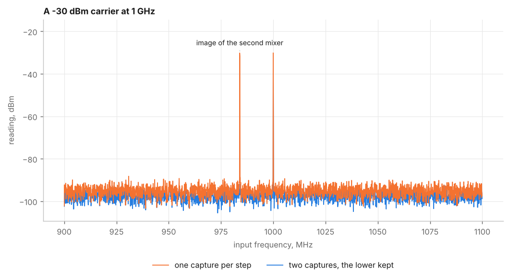

Close in (a 262144-sample capture, RBW 306 Hz), the reading follows the two LOs' datasheet profiles until the analyzer's noise floor takes over:

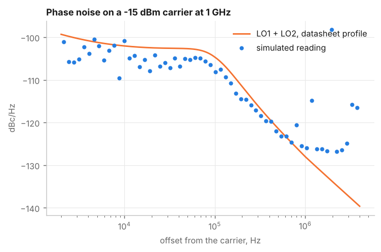

## Two tones, 1 MHz apart, -37 dBm each

| input attenuator, dB | tone reads, dBm | IM3 reads, dBm | IM3, dBc | from the budget's IIP3, dBc | each tone at the ADC, dBFS | floor, dBm |
|---|---|---|---|---|---|---|
| 0 | -37.0 | -119.6 | -82.6 | -83.5 | -10.5 | -127.4 |
| 10 | -37.0 | -106.4 | -69.4 | -103.5 | -20.5 | -117.9 |
| 20 | -37.0 | -99.0 | -62.0 | -123.5 | -30.5 | -108.1 |

With no attenuation the product is the chain's, near the budget's, whose cascade adds every stage's product in phase. Each 10 dB of attenuation should take it down 20 dB; what is left when it does not is the ADC's own distortion, which does not fall with the level.

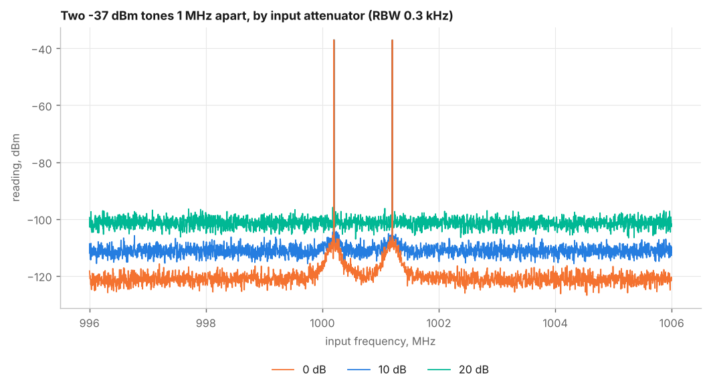

## The direct-sample path: 0.1 to 15 MHz

|  | reads, dBm |
|---|---|
| 3.3 MHz at -40 dBm | -40.0 |
| 27.2 MHz at -40 dBm, folded to 12.8 MHz | -106.7 |
| noise floor (median) | -110.5 |

Only low-pass filtering stands between this path and the ADC, so a signal between 22 and 38 MHz folds into it, less what those filters take off. Noise figure 21.9 dB, ADC full scale -26.3 dBm at the input with this attenuation.

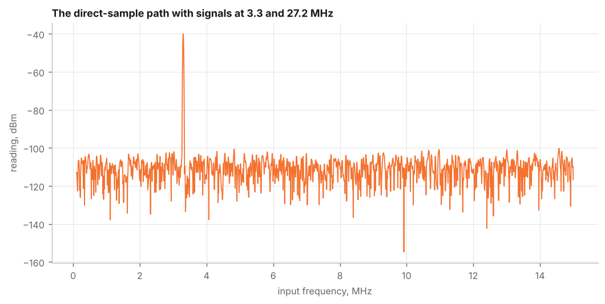

## Reading against input level (1 GHz, attenuator 10 dB)

The ADC's full scale is -16.5 dBm at the input (budget); the first clipped sample appears at -16 dBm, and the reading is 1 dB low from -14 dBm. The first stage to compress (the budget's cascade) does so at -12.9 dBm at the input.

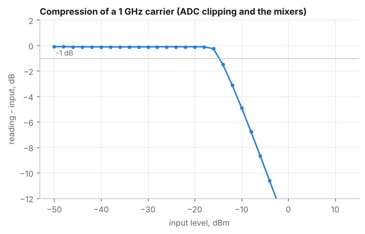

## A -10 dBm signal on the first IF (3.40 GHz), seen from the superheterodyne path

| while sweeping | input filters at the first IF, dB down | reads, dBm | dB under the signal | with two captures, dBm | made by |
|---|---|---|---|---|---|
| 0.5-0.7 GHz (L1) | 59 | in the noise | over 78 | -91.8 |  |
| 2.5-2.7 GHz (L2) | 44 | -76.1 | 66 | -89.6 | `1LO2-1[1x[IF1 signal] through SIM-83+]` |

What the input filters leave of it goes straight through the first mixer (its isolation between ports is the rest of the rejection) and reads at every tuning.

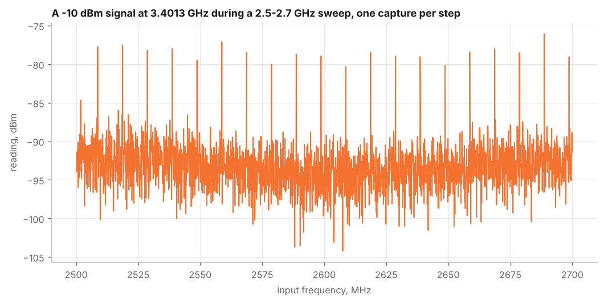

## The superheterodyne path with nothing connected

Noise floor: -99.5 dBm (median). Responses 15 dB or more over their step's floor:

| at, MHz | one capture, dBm | two captures, dBm | made by |
|---|---|---|---|
| 24.00 | -78.9 | -96.3 | `alias of [1LO2-1[LO1 x1 leak]] at an IF of 32.0 MHz, through the anti-alias filter` |

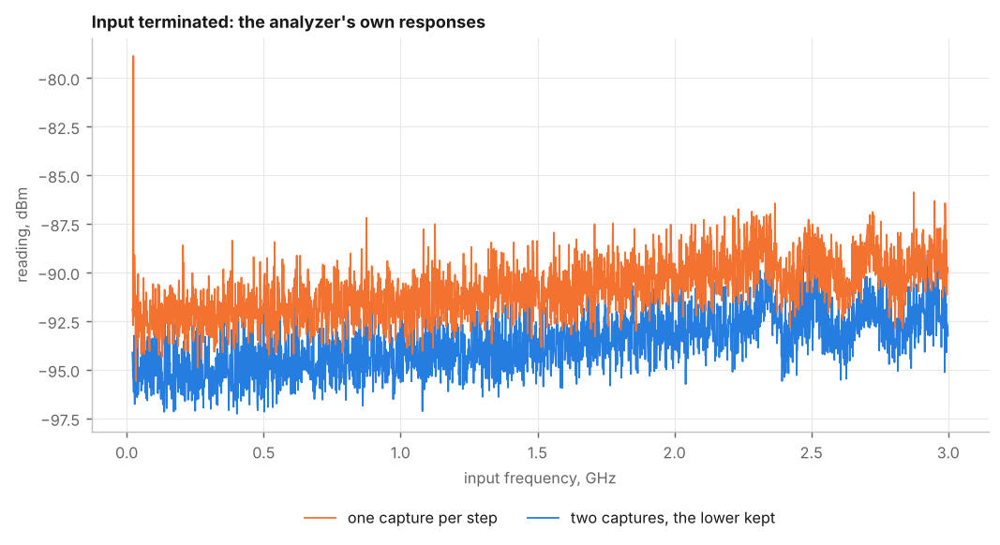

## The high band: a carrier at 5 GHz, and a bursting 18 MHz wide signal at 5.5 GHz

| reading, dBm | one capture per step | two captures, the lower kept |
|---|---|---|
| carrier, 5 GHz | -40.1 | -40.3 |
| image, about 24 MHz below | -40.1 | -89.6 |
| noise floor | -97.8 | -100.8 |

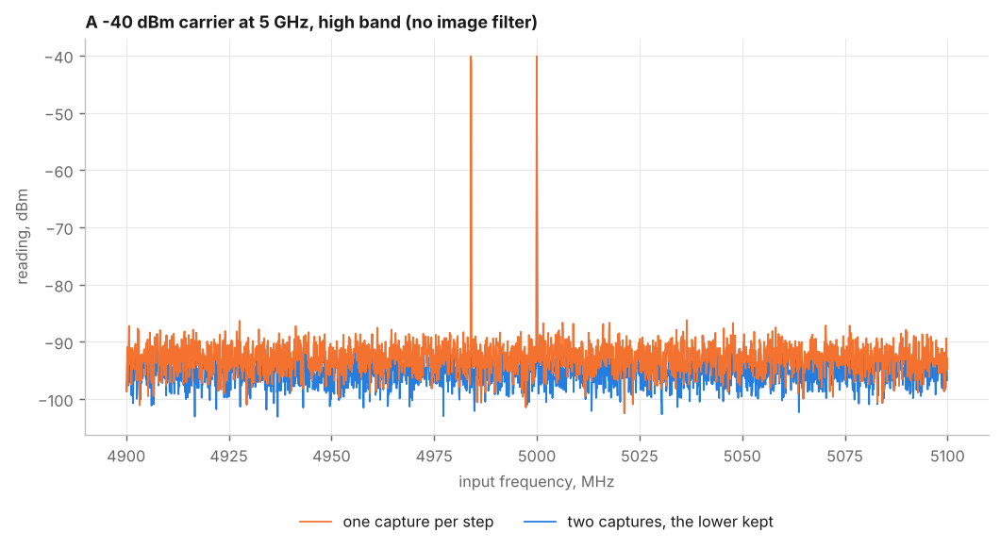

A noise-like signal 18 MHz wide, -40 dBm in total, is -69.6 dBm in this RBW. Steady, and then on for 35 % of the captures (each capture is 0.1 ms), max hold over eight sweeps:

|  | steady: reads, dBm | bursting: reads (median), dBm | bursting: share of its band shown | 24 MHz below: reads, dBm |
|---|---|---|---|---|
| one capture per step | -69.6 | -68.7 | 99 % | -70.9 |
| two captures, the lower kept | -72.5 | -92.6 | 16 % | -94.1 |

One capture per step shows the signal and its image side by side. Keeping the lower of two captures removes the image, but a step shows a bursting signal only when both of its captures caught it: the signal is shown in pieces, and low.

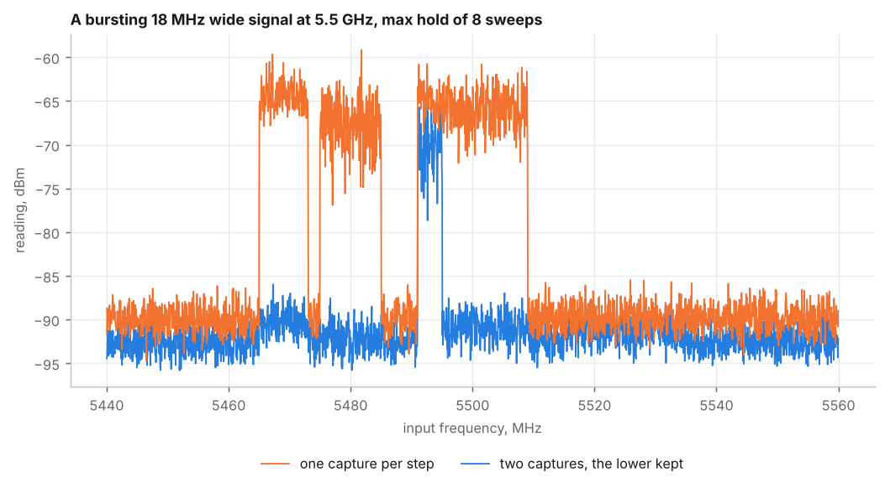

## 0.1 MHz to 6.40 GHz

| signal, MHz | level, dBm | reads, dBm |
|---|---|---|
| 3.3 | -45.0 | -45.0 |
| 100.3 | -45.0 | -45.0 |
| 915.2 | -35.0 | -35.3 |
| 1575.4 | -60.0 | -60.2 |
| 2440.1 | -40.0 | -40.0 |
| 5200.3 | -45.0 | -45.0 |
| 6200.3 | -45.0 | -45.0 |

Readings 15 dB or more over the local floor that are not the signals: 8 with one capture per step, 0 with two (0.0 % of the ADC's samples clipped at worst).

| at, MHz | one capture, dBm | two captures, dBm | made by |
|---|---|---|---|
| 888.80 | -35.2 | -94.5 | `1LO2-1[1LO1-1[915.2 MHz]]` |
| 2423.90 | -40.4 | -108.0 | `1LO2-1[1LO1-1[2440.1 MHz]]` |
| 5183.70 | -45.0 | -92.6 | `1LO2-1[5200.3 MHz]` |
| 83.70 | -45.0 | -99.4 | `1LO2-1[1LO1-1[100.3 MHz]]` |
| 6183.70 | -45.1 | -96.7 | `1LO2-1[6200.3 MHz]` |
| 1548.60 | -60.1 | -95.4 | `1LO2-1[1LO1-1[1575.4 MHz]]` |
| 24.00 | -79.3 | -95.4 | `alias of [1LO2-1[LO1 x1 leak]] at an IF of 32.0 MHz, through the anti-alias filter` |
| 19.17 | -90.9 | -98.2 | the skirt of `alias of [3LO2-1[SIM-83+ IM3 [LO1 x1 leak],[1LO1-1[3.3 MHz]]]] at an IF of 92.7 MHz, through the anti-alias filter` |

1923 captures of 4096 samples, 31 s of simulation.

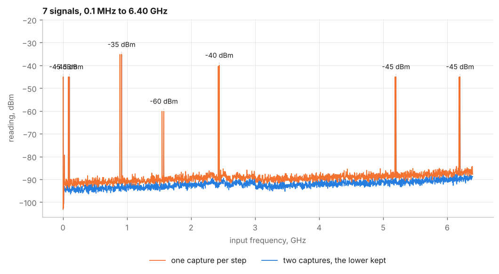

## One strong signal: 0 dBm at 915.2 MHz, attenuator 31.75 dB

The first mixer sees -40 dBm. The signal reads -0.3 dBm. Other readings 15 dB or more over the local floor: 3 with one capture per step, 0 with two (0.0 % of the ADC's samples clipped at worst).

| at, MHz | one capture, dBm | made by | two captures, dBm | and in the second capture by |
|---|---|---|---|---|
| 888.80 | -0.2 | `1LO2-1[1LO1-1[915.2 MHz]]` | -71.8 |  |
| 24.00 | -57.1 | `alias of [1LO2-1[LO1 x1 leak]] at an IF of 32.0 MHz, through the anti-alias filter` | -74.6 |  |
| 16.27 | -69.0 | the skirt of `alias of [3LO2-3[LO1 x1 leak]] at an IF of 96.0 MHz, through the anti-alias filter` | -75.5 |  |

`1LO2-1[1LO1-1[x]]` is the plain conversion of x: where it is not at x it is the second mixer's image. A reading at a whole multiple of the signal's frequency is the analyzer's own harmonic distortion.

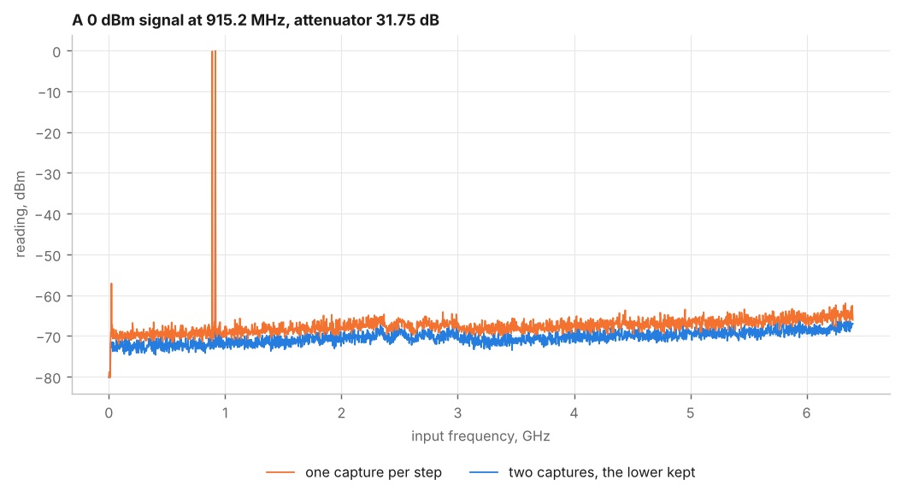

## Where each part's numbers come from

| part | source |
|---|---|
| DC block + limiter | assumed 0.3 dB (no part chosen) |
| input PE43704 (10 dB) | pSemi datasheet DOC-51214 tables 3-4 (typical insertion loss by band, IIP3, compression); past 7 GHz assumed |
| SW1 (band select) | pSemi PE42540 datasheet (typical insertion loss; past 8 GHz assumed) |
| LFCN-2250+ | datasheet specification points (LFCN-2250D+ table, read from a search result); past 5 GHz assumed |
| SW2 (L1/L2) | pSemi PE42540 datasheet (typical insertion loss; past 8 GHz assumed) |
| low band low-pass 4.0 GHz (radial stub N=7) | EM simulation (kicad2ems mom25d) of dfsynth's layout: data/if1_lpf_4g0_radial.s2p, 4.0 GHz, RO4003C 0.508 mm |
| low band preamp switch (in) | pSemi PE42540 datasheet (typical insertion loss; past 8 GHz assumed) |
| low band preamp switch (out) | pSemi PE42540 datasheet (typical insertion loss; past 8 GHz assumed) |
| 3 dB pad (mixer 1 IF port) | resistive pad (exact) |
| SIM-83+ | datasheet typ. (CL, isolations, IP3, via search results); spur table, port roll-off and P1dB assumed |
| IF1 amp PMA3-83LN+ | datasheet figures at 2 GHz (via search results); frequency slopes assumed |
| 6 dB pad (after the IF1 amp) | resistive pad (exact) |
| IF1 low-pass 4.0 GHz (radial stub N=7) | EM simulation (kicad2ems mom25d) of dfsynth's layout: data/if1_lpf_4g0_radial.s2p, 4.0 GHz, RO4003C 0.508 mm |
| IF1 band-pass (hairpin N=5) | EM simulation (kicad2ems mom25d) of dfsynth's layout: data/if1_bpf_3g4_hairpin.s2p, 3.4 GHz, 180 MHz, RO4003C 0.508 mm |
| SW5 (mixer 2 select) | pSemi PE42540 datasheet (typical insertion loss; past 8 GHz assumed) |
| SW1 (off path) | pSemi PE42540 datasheet (typical RFC-RFx isolation; past 8 GHz assumed) |
| SW3 (H1/H2) | pSemi PE42540 datasheet (typical insertion loss; past 8 GHz assumed) |
| H2 band-pass 4.3-6.4 GHz (stub N=5) | EM simulation (kicad2ems mom25d) of dfsynth's layout: data/h2_bpf_4g3_6g4_stub.s2p, 4.25-6.45 GHz, RO4003C 0.508 mm |
| H2 low-pass 7.0 GHz (radial stub N=7) | EM simulation (kicad2ems mom25d) of dfsynth's layout: data/h2_lpf_7g0_radial.s2p, 7.0 GHz, RO4003C 0.508 mm |
| SW4 (H1/H2) | pSemi PE42540 datasheet (typical insertion loss; past 8 GHz assumed) |
| high band preamp switch (in) | pSemi PE42540 datasheet (typical insertion loss; past 8 GHz assumed) |
| high band preamp (unpowered) | assumed 20 dB through an unpowered LNA |
| high band preamp switch (out) | pSemi PE42540 datasheet (typical insertion loss; past 8 GHz assumed) |
| SW5 (off path) | pSemi PE42540 datasheet (typical RFC-RFx isolation; past 8 GHz assumed) |
| L2 band-pass 2.3-3.0 GHz (interdigital N=7) | EM simulation (kicad2ems mom25d) of dfsynth's layout: data/l2_bpf_2g3_3g0_interdigital.s2p, 2.25-3.05 GHz, RO4003C 0.508 mm |
| H1 band-pass 3.0-4.5 GHz (stub N=5) | EM simulation (kicad2ems mom25d) of dfsynth's layout: data/h1_bpf_3g0_4g5_stub.s2p, 2.95-4.55 GHz, RO4003C 0.508 mm |
| H1 low-pass 5.0 GHz (radial stub N=7) | EM simulation (kicad2ems mom25d) of dfsynth's layout: data/h1_lpf_5g0_radial.s2p, 5.0 GHz, RO4003C 0.508 mm |
| direct-sample low-pass (30 MHz) | ideal 3rd-order Butterworth, 0.3 dB loss assumed |
| IF2 diplexer (LP arm, 30 MHz) | ideal 3rd-order Butterworth, 0.3 dB loss assumed |
| SW6 (IF select) | pSemi PE42540 datasheet (typical insertion loss; past 8 GHz assumed) |
| LMH6629 #1 (26 dB) | TI datasheet SNOSB18 (NF, HD2 and HD3 at 10 MHz, swing); bandwidth at Av=10 assumed |
| IF PE43711 (3 dB) | pSemi datasheet DOC-84940 table 3 (typical insertion loss by band; past 6 GHz assumed) |
| anti-alias LPF (elliptic N=9, 17.5 MHz) | ideal elliptic prototype, 1 dB loss assumed |
| LMH6629 #2 (26 dB) | TI datasheet SNOSB18 (NF, HD2 and HD3 at 10 MHz, swing); bandwidth at Av=10 assumed |
| THS4541 ADC driver | TI datasheet SLOS375 (HD2, HD3 at 10 MHz); noise figure estimated |
| IF PE43711 (0 dB) | pSemi datasheet DOC-84940 table 3 (typical insertion loss by band; past 6 GHz assumed) |
| LMX2572 | TI datasheet SNAS740 (-106 dBc/Hz at 100 kHz, 6.4 GHz; FOM -232); VCO profile shape assumed from the LMX2582's |
| SD9609-40 (as an AD9609-40) | AD9609 figures via a search result (SNR, SFDR); INL, DNL, jitter and the full scale assumed |

